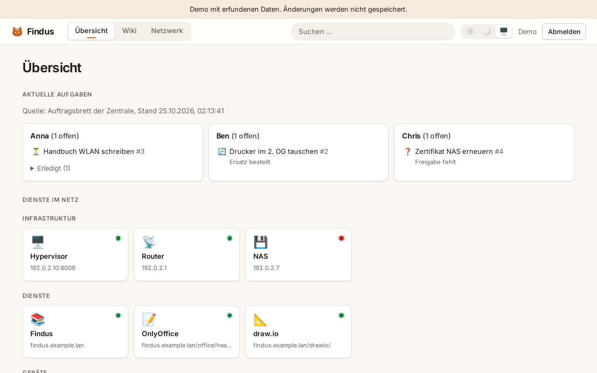

# Findus

**English** · [Deutsch](#deutsch)

Findus is a self-hosted internal wiki and documentation hub for small IT teams: a folder tree with wiki pages,
files with version history, Office documents in the browser (OnlyOffice), diagrams (draw.io) and a network map with
live status. Everything runs on your own server; nothing calls external services.

> **Status:** private preview. Try the [demo](#demo) (static, fictional data, no backend).

## Features
- Folder tree with areas, folders, pages and files; drag & drop, drafts and publishing
- Page editor (TipTap) with tables, code blocks, images and embedded draw.io diagrams; full version history with diff and restore
- Files with versions; Office files open and save in OnlyOffice, `.drawio` files in a self-hosted draw.io
- Network tab: rack and topology maps with live reachability, links to manuals and diagrams
- Full-text search (PostgreSQL, German stemming) over pages and documents
- Permissions per group with inheritance, public read-only areas, audit log
- Export of pages and folders as PDF or Markdown
- Dashboard of internal services with online status; light and dark theme per user
- Backup and restore scripts, isolated test stack

## Quickstart
Requirements: Docker with Compose.

    cp .env.example .env            # fill the secrets: openssl rand -hex 32
    docker compose up -d --build
    scripts/createsuperuser.sh      # create the admin account

Open `https://<WIKI_HOST>` (Caddy issues a certificate from its internal CA; trust it once in the browser).
The service dashboard reads `backend/services.json`; copy `backend/services.example.json` to start.

Tests: `docker compose run --rm -v "$PWD/backend":/app web pytest -q`.
Operations (backup, restore, permissions, in German): [docs/BETRIEB.md](docs/BETRIEB.md).

## Demo
`scripts/build-demo.sh` builds the frontend with a mocked API and fictional data into `demo-dist/`
(for GitHub Pages, see `.github/workflows/demo.yml`). Nothing in the demo is real.

## License
AGPL-3.0 (draft, see [LICENSE](LICENSE)). Fonts: Inter, SIL Open Font License.

---

## Deutsch
Findus ist ein selbst gehostetes internes Wiki und Dokumentationssystem für kleine IT-Teams: Ordnerbaum mit
Wiki-Seiten, Dateien mit Versionen, Office-Dokumente im Browser (OnlyOffice), Schaubilder (draw.io) und eine
Netzwerkkarte mit Live-Status. Alles läuft auf dem eigenen Server, ohne externe Dienste.

**Schnellstart:** `.env.example` nach `.env` kopieren und Secrets setzen, `docker compose up -d --build`,
`scripts/createsuperuser.sh`. Betrieb, Backup und Rechte: [docs/BETRIEB.md](docs/BETRIEB.md).
Eine statische Demo mit erfundenen Daten baut `scripts/build-demo.sh`.
