# Findus

**English** · [Deutsch](#deutsch)

Findus is a self-hosted internal wiki and documentation hub for small IT teams. One place for how-tos, network
documentation and files: a folder tree with wiki pages, files with version history, Office documents in the browser,
diagrams, rack and network maps with live status, and a public FAQ for your users. Everything runs on your own server
with Docker; nothing calls external services.

> **Status:** private preview. Try the [demo](#demo) (static, fictional data, no backend).

## Current version: <!--v-->0.8.6<!--/v--> · [Changelog](CHANGELOG.md)

The latest stable release is shown in the badge above and on the [Releases](https://github.com/Fe4ar/Findus/releases) page;
every release lists what changed in the [Changelog](CHANGELOG.md).

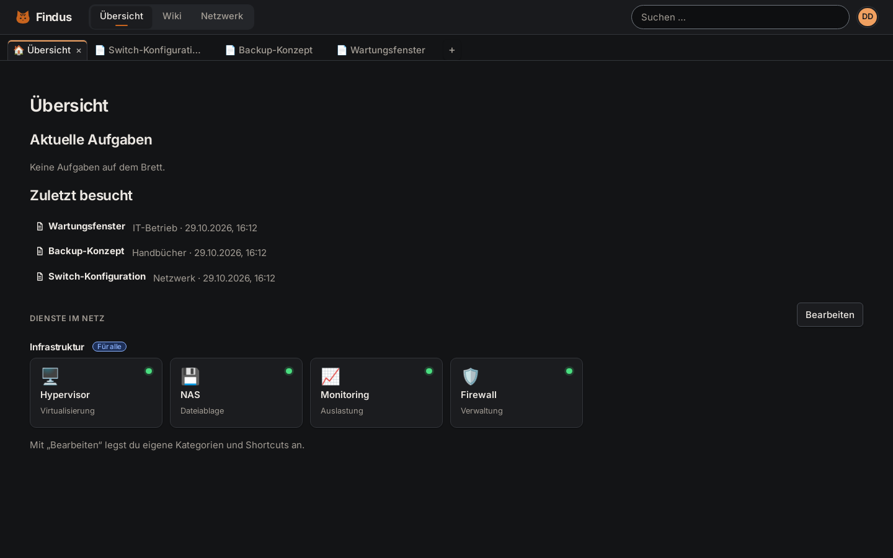

## What you get

**Knowledge base**
- Folder tree with areas, folders, pages and files; drag & drop, drafts and publishing, visibility badges in the tree
- Page editor (TipTap) with tables, code blocks, images and embedded draw.io diagrams; full version history with diff and restore
- Pages mix own text and embedded files: a document shows as a collapsed block and opens editable right on the page; screenshots can be pasted or dropped into the editor
- Files with versions; Office files open and save in Collabora Online (optional) or OnlyOffice, `.drawio` files in a self-hosted draw.io
- Import and export of whole folders (Markdown ZIP with attachments)
- Full-text search (PostgreSQL, German stemming) over pages and documents, all words required, filters (private, teams) and an exact mode; export of pages and folders as PDF or Markdown

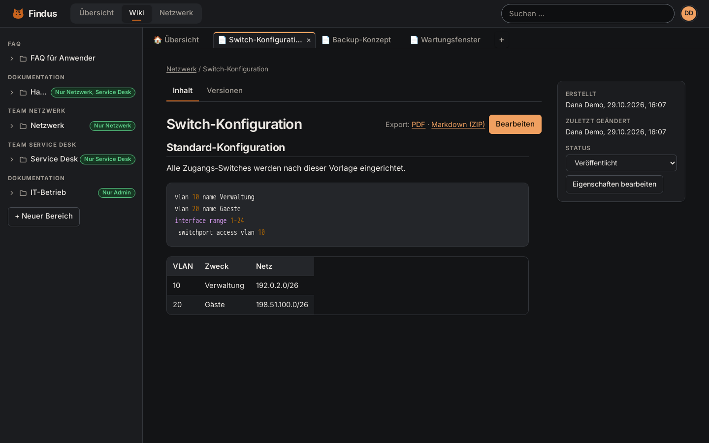

**Network documentation**
- Rack and topology maps: 16 device types with front graphics, snapping into rack units, front/back view, ports and cables
- Live reachability per device, cable colours by medium or VLAN, rack metrics (units, power, weight), search inside maps
- Undo/redo, copy/paste, multi-select, export as SVG or PNG; link devices to manuals and diagrams

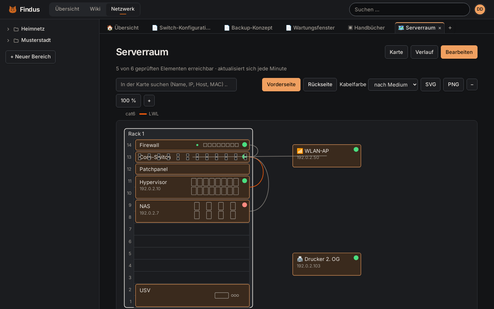

**Teams and permissions**
- Teams with their own knowledge area, members, leaders and a read or read/write right per member; a team may start empty
- A team's leader shares a folder with other teams (read or edit, shown by a small icon); a personal private area per user that nobody else, not even an admin, can read
- Permissions per group with inheritance down the tree, per-user download/export right, audit log
- Functions per team (wiki, FAQ, tasks, network, export) can be switched on and off; team leaders manage their own
- Trash per team with retention and a purge timer; page view counter and statistics
- Own password change in the profile; login lock after repeated failures (per user and address), HSTS and a strict Content-Security-Policy, document servers only for signed-in users

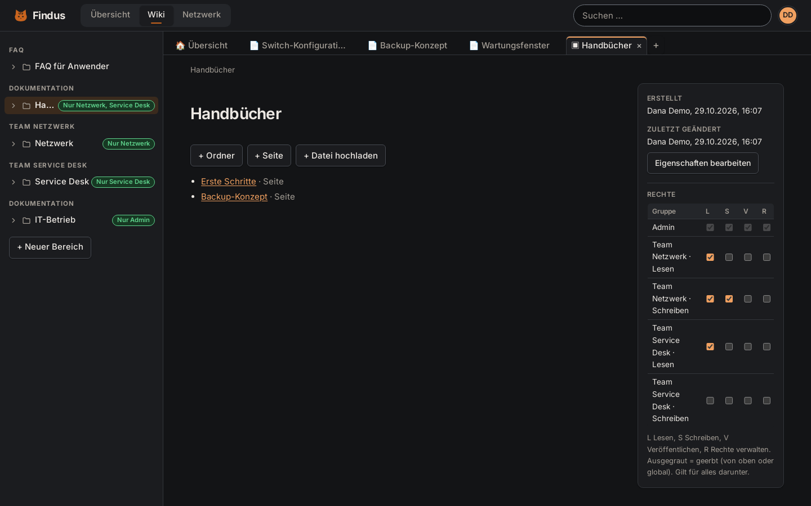
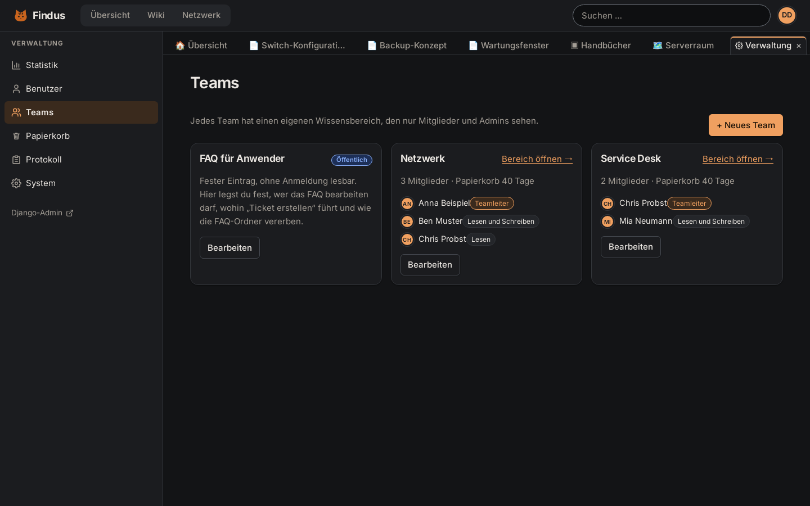
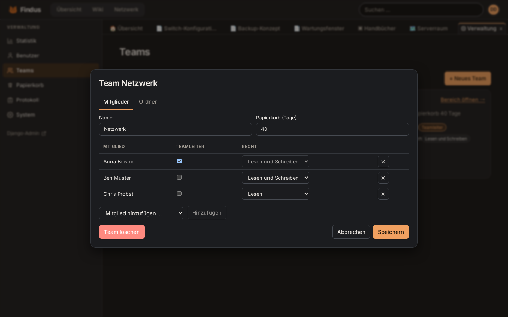

**Public FAQ for your users**
- Anonymous read-only landing page with search, most read posts, categories and an optional "create ticket" link
- Named FAQ editors (people or teams); everything else stays behind the login
- Optional separate help portal host for people without an account (only the FAQ and its read-only API are served there)

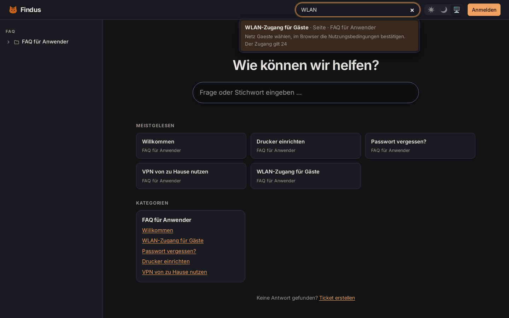

**Everyday use**
- Task list per user with sections, drag & drop and a menu fallback, tasks for teammates, optional two-way sync with a personal Todoist project (API token stored encrypted)
- Dashboard of internal services with online status; personal, team and global shortcuts; "recently visited"
- In-app tabs (pin, reorder, split view), light, dark and system theme per user, keyboard friendly dialogs
- Administration for users, teams, trash, audit log and system status; backup and restore scripts, isolated test stack

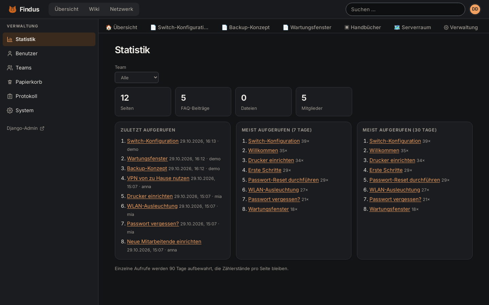
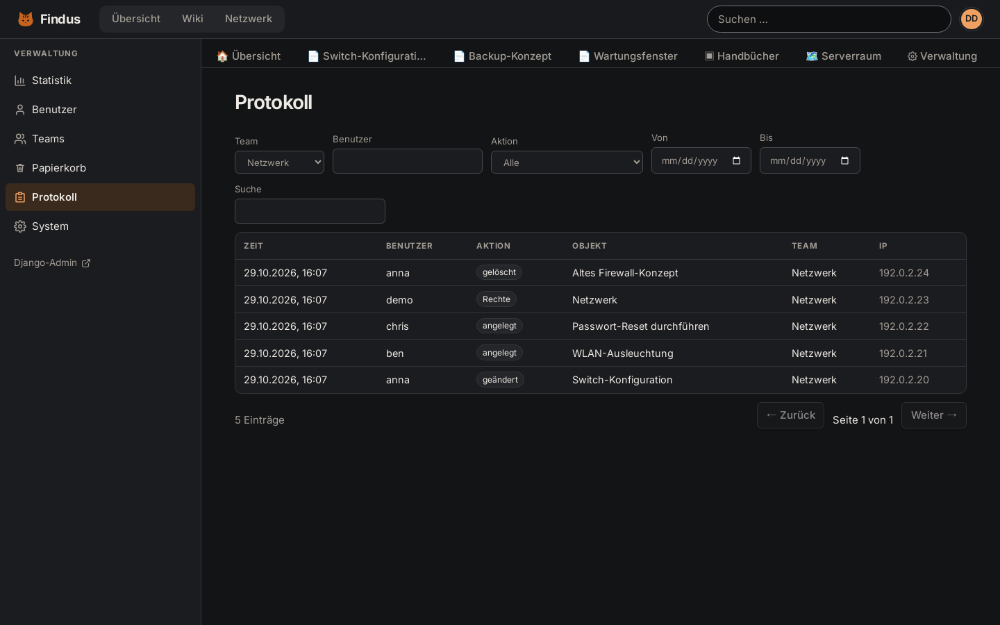
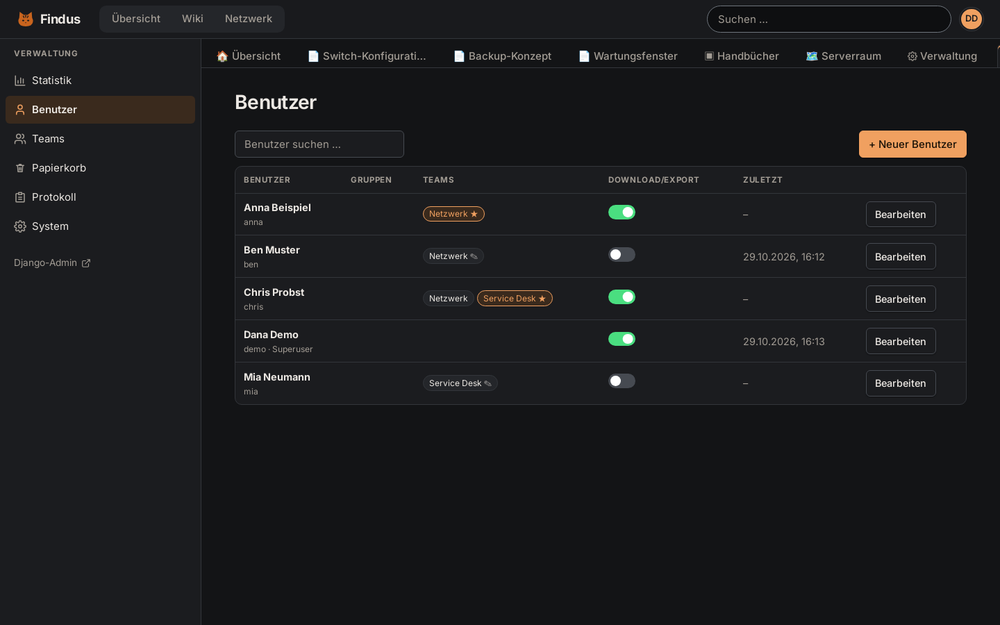

Light theme (every user picks theirs in the profile menu):

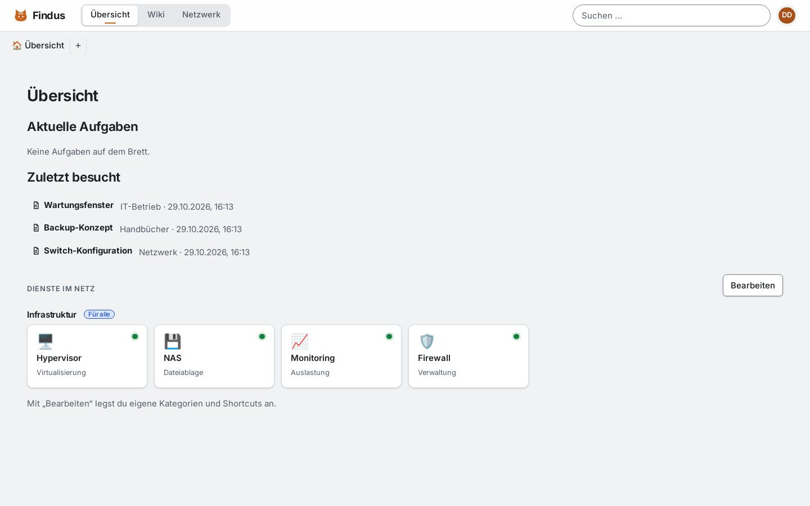

The screenshots show a throwaway instance with fictional data.

## Quickstart
Requirements: a Linux server with Docker and the Compose plugin, 3 GB RAM or more (OnlyOffice needs about 750 MB), 10 GB disk.
If Docker is missing: `curl -fsSL https://get.docker.com | sudo sh`, then `sudo usermod -aG docker $USER` and log in again
(otherwise every command needs `sudo`).

    cp .env.example .env            # set WIKI_HOST (name or IP of the server), fill the secrets: openssl rand -hex 32
    docker compose up -d --build    # first start: 5–10 minutes (frontend build, images of about 3 GB)

A fresh installation (no user yet) creates the administrator **`admin`** with the password **`admin1234!`** on its first start.
The first login forces a new password before anything else works, and the start password works only once.
**Change it immediately after the first start**, and do not expose a fresh installation to the internet before you did:
anyone who knows this default could otherwise sign in first.

`scripts/createsuperuser.sh` is optional now (own admin name, or a script without the start password):
`DJANGO_SUPERUSER_PASSWORD=… scripts/createsuperuser.sh admin you@example.org`. Installations that already have users are not touched.
Check with `docker compose ps` (all five services up) and `curl -k https://<WIKI_HOST>/api/health`.

Open `https://<WIKI_HOST>`. Caddy signs the certificate with its own CA, so browsers warn on the first visit.
Either accept it once, or trust the CA on your clients: `docker compose cp caddy:/data/caddy/pki/authorities/local/root.crt .`
and import `root.crt` into the operating system or browser certificate store. For a public name, put a reverse proxy
with a normal certificate in front and list its name in `WIKI_ALIASES` / its address in `TRUSTED_PROXIES`.

After the first login (and the new password) the overview shows a short "first steps" hint: create dashboard categories and shortcuts per user,
set up teams under Administration → Teams. The optional `backend/services.example.json` is read once when the database is
created (copy it to `backend/services.json` before the first start) and becomes the global shortcuts.

Daily backup and trash purge: `scripts/install-timers.sh` (installs systemd timers for the current user and path).
Everything else, in German: [docs/BETRIEB.md](docs/BETRIEB.md).

Update to a new release: take a backup (`scripts/backup.sh`), pull the new version, `docker compose up -d --build`;
database migrations run on start. Read the [Changelog](CHANGELOG.md) first.

Tests: `docker compose run --rm -v "$PWD/backend":/app web pytest -q`.

## Demo
`scripts/build-demo.sh` builds the frontend with a mocked API and fictional data into `demo-dist/`
(for GitHub Pages, see `.github/workflows/demo.yml`). Nothing in the demo is real.

## License
AGPL-3.0 (draft, see [LICENSE](LICENSE)). Fonts: Inter, SIL Open Font License.

---

## Deutsch
Findus ist ein selbst gehostetes internes Wiki und Dokumentationssystem für kleine IT-Teams: Ordnerbaum mit
Wiki-Seiten, Dateien mit Versionen, Office-Dokumente im Browser (OnlyOffice), Schaubilder (draw.io), Rack- und
Netzwerkkarten mit Live-Status, Teams mit eigenen Wissensbereichen und Rechten sowie ein öffentliches FAQ für Anwender.
Alles läuft auf dem eigenen Server, ohne externe Dienste.

**Aktuelle Version: <!--v-->0.8.6<!--/v-->** – was neu ist, steht im [Changelog](CHANGELOG.md) und bei den [Releases](https://github.com/Fe4ar/Findus/releases).
Die Bilder oben zeigen eine Testinstanz mit erfundenen Daten, hier im dunklen Design; das helle Design gibt es zusätzlich.

**Schnellstart:** `.env.example` nach `.env` kopieren und Secrets setzen, `docker compose up -d --build`,
Eine frische Installation legt beim ersten Start den Administrator `admin` mit dem Passwort `admin1234!` an; der erste Login erzwingt ein neues Passwort (bitte sofort ändern, die Installation vorher nicht ins Netz stellen). `scripts/createsuperuser.sh` ist optional (ohne Rückfrage: `DJANGO_SUPERUSER_PASSWORD=… scripts/createsuperuser.sh <name>`). Der erste Start dauert
5–10 Minuten, das Zertifikat stammt von Caddys eigener CA (Vertrauen: siehe Quickstart oben). Timer für Backup und Papierkorb:
`scripts/install-timers.sh`. Betrieb, Backup und Rechte: [docs/BETRIEB.md](docs/BETRIEB.md).
Eine statische Demo mit erfundenen Daten baut `scripts/build-demo.sh`.
